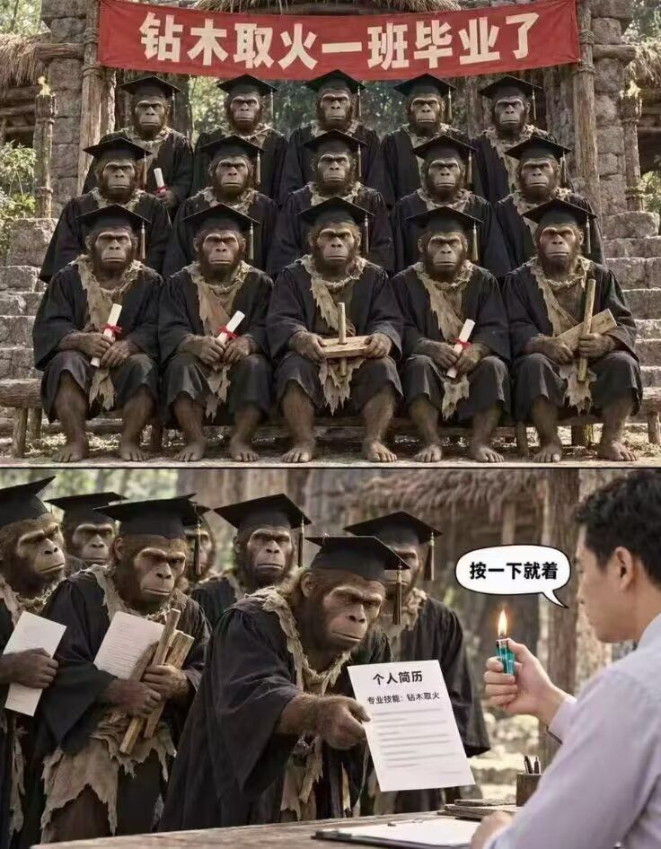

&emsp;&emsp;最近经常能在互联网上的各种地方看到上面这张梗图。可能是由于当代QQ群去中心化的传播路径吧，同一张梗图总是会被不同的人在同一个地方反复传来传去，但每次再看见它，我都会忍不住觉得，这简直就是我目前人生状态的真实写照。虽然（用AI）做出这张图的人的初衷大概只是搞笑，但我却笑不出来，因为它好笑的地方恰恰在于它一点都不好笑。如果真的存在某条与图中对应的平行世界线，在那里钻木取火大约也曾经算是一种前沿技术，那么能进“钻木取火一班”的，当年应该也是亲戚朋友口中“别人家的孩子”。我想这些“钻木取火一班”的猩猩在拍毕业照的那天，大概也会认为自己是“抓住了时代的风口”吧。但它们毕业即失业，口中那些所谓“前沿研究”的存在价值被一个打火机炸得一干二净，最后混得甚至还不如那些“只能去工地搬砖”的“自己家的孩子”。

&emsp;&emsp;我觉得我也是其中的一只猩猩。

&emsp;&emsp;认识我的人都知道，我的研究方向是基于深度学习的故障诊断，或者在往自己脸上贴金的时候会说是PHM（Prognostics and Health Management，故障预测与健康管理）。我在博士刚入学的时候，对于自己选择的这个方向其实是相当满意的，因为这本质上是一个机械和计算机的交叉学科，而我相比于绝大多数机械专业的学生，拥有可以说是牛到不行的编程能力；而由于神经网络模型那众所周知的可解释性老大难问题，机械专业的人过去积累的那些理论机理可以说是毫无用处。所以我当时的想法很简单，就是凭借自己在计算机方面的知识，对这个领域的其他研究者进行降维打击，然后批量刷取SCI论文。当然后来我也确实在相当程度上做到了这一点。课题组里比我勤奋的人虽然不少，比我聪明的兴许也有，但他们的论文出来得没那么快，因为他们得先学会写代码；而我只需要每天在宿舍里躺着打游戏，等我的全自动化脚本“种菜”完工，再不紧不慢地去实验室收一趟菜就行了。

&emsp;&emsp;后来，ChatGPT诞生了。虽然那个时候的GPT还相当弱智，需要我花半天时间给它解释我到底在研究什么东西，它最后还是会输出一些莫名其妙的东西，但至少我再也不用因为自己的论文不够nativeEnglish而发愁了。

&emsp;&emsp;再后来，大约是随着梁圣开源了他的“深度求索”和整套思维链推理框架吧，各家国产的开源LLM也都陆续诞生了。这些模型甚至更加弱智，以至于在研究学术问题时几乎没有任何作用，所以我还是在用ChatGPT。但我还是很感激他们，因为这些模型是开源的，它们的能力和价格就是GPT的催命符，就像有一条斩杀线永远跟在OpenAI身后，逼着奥特曼必须一刻不停地向前发展，还不能把模型定价定得太贵。到了这时候，AI也逐渐成了我科研过程中不可或缺的一部分：从和我讨论课题，到帮我修改老师提出的问题，再到应付老师丢过来的各种杂活，我发现自己越来越多地把工作交给了AI。

&emsp;&emsp;不过即便是在那个时候，我也依然觉得自己相比于别人有相当大的优势。因为虽然大家都能用AI，但我大概是其中最优秀的驾驶员。我知道AI能干什么、不能干什么，知道在哪些问题上需要为它补充什么样的上下文，甚至可以在它的推理能力还不足以支撑整个任务的时候，手动帮它构建CoT，或者根据不同模型的特点，把一个任务拆成几部分交给不同的AI去完成。所以在很长一段时间里，我其实是相当欢迎AI发展的。因为AI越强大，我能借助它完成的工作就越多，而凭借我对AI的理解，我依然可以比别人做得更多。

&emsp;&emsp;然后，harness时代到来了。

&emsp;&emsp;大约就在今年年初，Claude Code还只是个没多少人听过的前卫玩意，那时候Codex还叫Copilot而且非常难用，而中文互联网上正经历着“全民养虾”的狂欢，到处都有人在问怎么安装，甚至连平时看新闻几乎只靠抖音的我妈，都跑来问我什么是养虾。当时的我其实也答不太上来，毕竟交叉学科距离计算机领域的前沿总是存在一段距离，所以我总能在计算机领域找到一些没人吃的剩饭，再搬到我所在的领域，就成了香饽饽。现在我能回答了：我觉得Openclaw大约就是如今人人都在用的harness的雏形，只不过它不太好用，所以在其他竞品的攻击下市场占有率逐渐走低，之后被梁圣的DeepSeek harness彻底斩杀掉了。如今在网上搜Openclaw，只能零零散散看到几个吃屎都赶不上热的人还在问，这玩意装上之后该怎么卸载。

&emsp;&emsp;然而就在这短短不到一年的时间里，各种各样的harness已经逐渐普及，隔三岔五就能看到AI又解决了哪个数学家研究了几十年乃至上百年都没能解决的问题；前几天Anthropic的研究人员甚至已经宣称借助Claude完成了对黎曼猜想的证明，虽然整个证明过程足有上千万行，根本不是人类能验证的，而且这也不影响他们的股价破发。所以虽然现在再去感慨AI的发展速度多少有点水字数的嫌疑，但我觉得这大概是一切讨论的前提。毕竟在过去，人类社会还很少出现一种技术，能在一个人读完高等教育所需的时间里，反复改变这个人接受高等教育的意义。而我现在所扮演的，恰好就是这么一个即将完成高等教育的人。

&emsp;&emsp;昨天早上我看了个视频，叫[《今天体验的人生副本是：沉迷vibecoding走火入魔的AI嘉豪》](https://www.bilibili.com/video/BV1qJs16WEJj)。虽然作者的本意大概也只是搞笑，但不知怎么的，我看完只觉得非常难受。

&emsp;&emsp;这个视频的文案其实也很有AI味，一看就是AI编的。它讲一个叫嘉豪的人，高考数学和物理成绩都不太好，进了个双非的计算机专业；由于在B站刷到“不会编程，用AI三天开发一个App”的视频，于是斥重资在闲鱼买了台二手MacBook，然后花三个小时用AI做出一个待办清单。他激动得整晚没睡，截图发朋友圈配文“build something people want”，没有人点赞。后来他做出27个App，累计下载19次，其中17次是他自己。毕业答辩时，老师问他这个系统的基本架构是什么，他答“主要是通过多agent的协同实现端到端智能化工作流”；老师说我是指，你数据库用的什么；他愣住了，打开Cursor想让AI帮他回答，结果屏幕上只弹出一行字：Usage limit reached。

&emsp;&emsp;我笑到这里的时候突然笑不出来了。因为就在几天前，我也写过一篇类似的杂谈，甚至题目就叫《Codex额度用完之后》。

&emsp;&emsp;在视频的最后，45岁的嘉豪终于还是没有找到任何像样的工作，只好去电子产品回收站上班。某天，他收到一台老MacBook，就是他当年用过、后来因为生活窘迫被迫卖掉的那一台。开机后，桌面上躺着一个叫“改变世界的创业项目finalfinal终极版”的文件夹。视频的结论是：他这辈子最大的错误，是在18岁那年接触了AI。

&emsp;&emsp;看到这里我忍不住想，如果嘉豪的错误是接触了AI，那我呢？也许我本质上也只是个AI嘉豪，只不过比视频里这位侥幸早出生了几年，得以在AI普及之前，凭借一些现在已经不怎么值钱的知识混到一个相对比较高的学历而已。但现在我和他又站在了同一个地方，手里同样握着0个offer，区别可能仅仅在于：我手里比他多一张废纸，纸上写着我是博士。可是，博士又有什么用呢？

&emsp;&emsp;前段时间，我导突然莫名其妙地丢给我一个本科生让我带，而这个本科生恰好就属于很会用AI的那一种。由于前期我也确实带了他一段时间，对他的基本情况有所了解，所以当他仅仅开始研究一个月，就把论文初稿发给我的时候，我一眼就看出这玩意不可能是他自己写的。文章里的AI味也很典型，让我光是闻着味就知道他用的是哪家模型，但最主要的问题在于他写得太好了，完全高出了他应有的水平。

&emsp;&emsp;我没有说破。我说挺好，只要把这里再改改，就可以准备投稿了。当然我也说不破，因为现在我自己的论文也是这么写的，区别可能只在于我的提示词比他长——但更长的提示词，对当代的大模型来说也未必是件好事。

&emsp;&emsp;所以我听说现在各大学术期刊的投稿量全都爆炸了，很多期刊仅今年一年的投稿量就超过了从创刊到去年的总和，其中充斥着和这位本科生一样，只花几块钱token就批量生产出来的学术垃圾。当然我可能也没资格批判他们产出的垃圾，因为我自己的研究可能比这些AI水货更垃圾，甚至AI做实验时可能比我更严谨。我生产的垃圾和AI生产的垃圾，最大的差别就在于：这些垃圾是我亲手生产的，而不是我委托某个第三方生产出来的。而这些垃圾如果放到现在再投，大概率是发不出来的。

&emsp;&emsp;所以我现在之所以能站上答辩的演讲台，靠的从来都不是我自己的能力，而是某种“入场时间”。由于我入学那年LLM还没诞生，我才躲过了现在这场投稿海啸，得以在一个还认“工作量”的系统里把桶灌满。但现在洪水来了，我桶里的东西再也没有什么价值。我就像是图片里“钻木取火一班”的其中一只大猩猩；而我带的那个本科生恰好比我晚生了几年，所以他一上手就有打火机。

&emsp;&emsp;在AI还没发展到今天这个程度的时候，我其实是个对未来充满期待的人。我脑子里总是有很多乱七八糟的想法，想做各种各样的软件，想研究各种各样的东西，也经常因为想实现某个其实根本没什么用的点子，去学一些和自己的专业八竿子打不着的知识。虽然这些项目绝大多数都因为我没有时间或者单纯犯懒而被搁置了，还有相当一部分做了一半就被我自己弃坑，但那个时候的我其实是很快乐的。因为那时候我总觉得，自己既有想法，又有把想法付诸实践的能力，同时还拥有大把的时间。而这三个条件能够同时满足，在我看来是相当难得的事情。所以虽然我暂时还没做出什么特别了不起的东西，但我总觉得，只要等到一个合适的时机，把脑子里积攒的那些点子都实现出来，我大概就可以像网上曾经流行的那句话说的那样——悄悄努力，然后惊艳所有人了。

&emsp;&emsp;后来AI来了。那些过去可能需要我花几个月业余时间才能完成的东西，现在只需要消耗一丁点token就能做出来。对于一个积攒了一大堆烂尾项目的人来说，这简直就是梦想照进现实。一开始我当然很高兴，但当我真的把这些东西一个个做出来之后，就逐渐发现：它们并没有我过去想象的那么好，我也并没有因为做出它们而惊艳到什么人。现在想想，在过去很多年里真正让我快乐的，也许并不是那些项目本身，而是那些尚未完成的项目所赋予我的、关于未来的想象空间。只要还没做出来，我就始终可以觉得自己只是缺少时间，始终可以觉得脑子里装着一大堆足以惊艳所有人的东西。而现在AI帮我把它们做出来了，我终于不得不面对一个事实：我的这些想法其实也没什么了不起的。

&emsp;&emsp;最近听说AI已经能够自己做视频了。为了最后再努一把力，宣传一下我做出来的这一坨东西，我也没忍住，让AI帮我做了两个。视频发出去，没有人看。我在群里又硬着头皮安利了几次，群友的回复依次是“哈哈”“牛逼”“回头试试”，但仍然没有人试。

&emsp;&emsp;做视频的时候我还发现，AI做的视频其实是高度模板化的。摸清楚这一点之后再去看B站，就会发现大量科普视频是这么批量生产的。以前我能一眼看出来哪些是自动生产的，是因为它们质量真的差，甚至有些洗稿的原稿我都看过；但现在很多视频，如果不是因为这次偶然的经历，说实话我已经分不太出来了。我甚至觉得这些AI生成的视频很有3Blue1Brown的风格，而后者是全世界最顶级的科普作者之一。我自己过去（大约是为了装逼）也学过一些视频制作的基本技术，比如PR和AE，而现在AI在这个领域又一次地把我完爆了。

&emsp;&emsp;在这个过程中，最让我难过的一点是：我发现这个世界上有想法的人，其实远比我过去想象的要多。过去他们可能只是苦于自己不会编程、不会画画，或者缺乏某个领域的专业知识，所以没办法把想法变成现实；而现在大家终于都能相对公平地通过prompt向AI许愿了。对于一个过去单纯因为不会编程而无法实现自己想法的人来说，AI的出现大概是一件比我更值得高兴的事。毕竟对方只是获得了原本不具有的能力，而我在获得这些能力的同时，还要眼睁睁地看着自己过去引以为傲的那些能力逐渐失去价值。这大概也是一种相当嘉豪的心态了。

&emsp;&emsp;所以其实我也只是一个大号的AI嘉豪罢了，又或许甚至都不是大号的。

&emsp;&emsp;那么，学习还有什么意义呢？

&emsp;&emsp;这其实是最近一直困扰着我的问题。过去我是个相当喜欢学各种乱七八糟东西的人。一方面是因为了解一些自己过去不了解的东西本身就很有意思；另一方面是因为每当我掌握了一项新知识或者新技能，就会发现自己又多了一些能做的事，而这些事又会给我带来更多的想法。所以即便过去的我没有什么明确的人生规划，我也总觉得，只要自己还在不断学习，未来总归会比现在更好。

&emsp;&emsp;但现在，至少对于绝大多数普通人而言，他们的知识储备已经完全没有办法和AI相提并论了，更何况AI还可以联网。而在解决实际问题的能力上，AI甚至已经开始解决人类最顶尖的数学家穷尽毕生精力也未能解决的问题了。在这个前提下，一个普通人花上若干年去学习某个领域的知识，究竟还有多少现实意义？这也让我开始怀疑：我过去所理解的那些“兴趣爱好”、“自我提升”乃至“自我实现”，其中究竟有多少是真正来源于我对这些事情本身的喜爱，又有多少只是来源于一种隐蔽的优越感。

&emsp;&emsp;如果有一天，我学习任何知识都不再能提升自己的社会竞争力，我还会像过去那样热衷于学习吗？

&emsp;&emsp;如果有一天，我所能创造出来的任何东西，别人都只需要向AI许一个愿就能获得，我还会像过去那样拥有强烈的创作欲望吗？

&emsp;&emsp;我不知道。

&emsp;&emsp;我甚至有时候会觉得：如果按照目前AI的发展速度，AGI或许真的会在未来几年内实现，甚至能够通过自我迭代不断提升自己的能力，那么对于绝大多数和AI前沿发展无关的人而言，现在最聪明的选择大概就是在经济条件允许的范围内原地躺平，好好享受自己的人生。因为我们辛辛苦苦花若干年取得的一点点进步，在AI的进步速度面前可能真的显得尤为可笑。

&emsp;&emsp;当然，这个想法也存在一个相当实际的问题：如果AGI并没有如期而至，或者即便AGI真的实现了，普通人也并不能享受到由此带来的生产力红利，那么提前躺平的人大概还是会死得相当难看。所以即便我现在真的相信AGI会在未来几年内实现，我大概也还是不得不继续做那些在我预期中很可能会迅速失去价值的事情。

&emsp;&emsp;在AI的发展过程中，很多人都在争论它到底能不能算第四次工业革命。有些人认为，AI并没有像前几次工业革命那样大幅提升工业生产效率；但也有些人认为，AI几乎彻底优化掉了“人”这个环节在生产过程中本来要起到的作用，又何尝不能算一种生产关系上的革命？而在我看来，AI的发展所导致的最严重后果，可能并不是人类的工作被AI取代，甚至也不是某些职业从此消失在历史长河中，而是人类对自身存在意义的理解会发生相当大的变化。

&emsp;&emsp;从小到大，我们所接受的教育基本上都是围绕一套相当完整的逻辑进行的：我们需要好好学习，因为学习能让我们掌握更多的知识和技能；我们需要掌握这些知识和技能，因为它们能帮我们在社会中找到一份好工作；而我们通过工作为社会创造价值，同时也从社会中获取相应的回报，以此实现自己的人生价值。然而如果有一天，我们已经无法通过学习在智力上获得相对于AI的任何优势，同时我们所能从事的绝大多数生产性劳动也都能被AI以更低的成本、更高的效率完成，那么这套逻辑大概就需要被彻底重构了。当绝大多数人所能提供的劳动不再被社会需要的时候，这些人究竟应该通过什么方式获得维持生活所需的资源？生产力的极大发展并不必然意味着所有人都能享受到它的成果，至少人类目前的社会制度显然还没有为这种情况做好准备。

&emsp;&emsp;当然，从整个人类文明发展的角度来说，我依然觉得能在有生之年见证AI的发展是一件非常幸运的事。如果人类真的能借助AI解决过去无数代人都没能解决的问题，乃至最终从绝大多数生产性劳动中解放出来，那大概确实是人类文明史上最值得庆祝的事情之一；只是我不知道自己在这个未来中究竟应该扮演一个什么样的角色。

&emsp;&emsp;过去我总觉得自己还有很多东西可以学，还有很多事情可以做，还有很多成为很厉害的人的可能。而现在我发现，虽然自己能做的事情比过去多了无数倍，对未来的期待却反而越来越少。

&emsp;&emsp;或许未来的人们从出生开始就不需要再以生产性劳动作为人生价值的主要来源，他们能很自然地接受这样一种全新的人生，并且能从各种各样我们现在无法想象的事情中获得快乐；如果真是这样，那大概也是一件相当好的事。只不过对于我们这些恰好出生在这个时代的人而言，我们可能还需要花相当长的时间，去忘掉我们过去花了相当长时间才学会的那些关于人生的道理。

&emsp;&emsp;不过这些事情可能暂时还不是我应该考虑的。毕竟在AGI实现之前，我大概还是得先找份工作养活自己。

&emsp;&emsp;唯一值得庆幸的是，折腾了这么多年，我的博士终于快毕业了。

&emsp;&emsp;钻木取火一班毕业了。

&emsp;&emsp;恭喜我自己。
